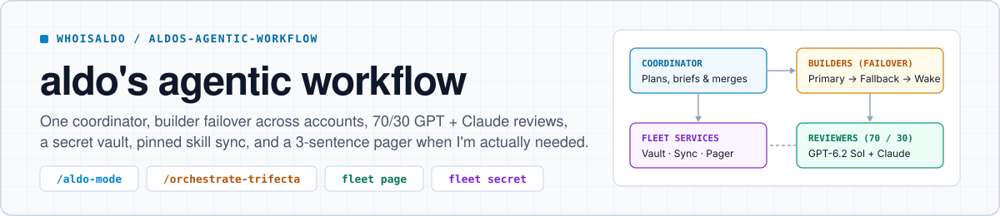
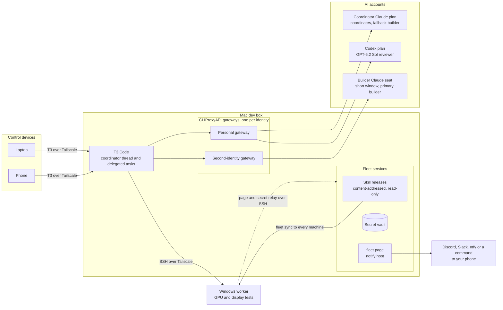

<p align="center">
  <picture>
    <source media="(prefers-color-scheme: dark)" srcset="assets/header-dark.svg">
    
  </picture>
</p>

<p align="center">
  <a href="LICENSE"></a>
  <a href="docs/skills.md"></a>
  <a href="docs/fleet-cli.md"></a>
</p>

# aldo's agentic workflow

I'm Ali, or you can call me Aldo. I build systems, infra, iOS, and web tools, and I drive most of my coding agents from my laptop or phone while a Mac dev box and a Windows GPU PC do the real work.

Most agent workflows assume one account, one model, and someone sitting in front of the terminal. That falls apart the first time you hand an agent a real multi-hour build. You hit a 5-hour usage cap and the run dies. Or the same model reviews its own patch and approves the exact bug it just wrote. Or a Windows UAC prompt sits on screen for six hours while you are away.

**This is my setup.** These are the actual skills, orchestration rules, and CLI tools I run every day. Stacks like pstack teach an agent how to think inside one session. This repo solves what happens around the session: splitting coordinator, builder, and reviewer roles across accounts, failing over when a usage window closes and switching back when it reopens, routing GPU work to a Windows box, keeping keys in one vault, syncing pinned skill releases across machines, and paging my phone in three sentences only when a human actually has to step in.

**One front door, pick what you want underneath.** Start with [`/aldo-mode`](skills/aldo-mode/SKILL.md) and let it pick the right skill for the job, or install only the skills you care about. Everything specific to my machines and accounts lives in two local config files (`fleet.json` and `trifecta.json`), never in this repo.

Fork it, gut the parts you don't need, make it yours. PRs are welcome.

## Install

<details>
<summary><strong>Claude Code (plugin marketplace)</strong></summary>

Run in Claude Code:

```text
/plugin marketplace add whoisaldo/aldos-agentic-workflow
/plugin install aldo-workflow@aldos-agentic-workflow
```

Claude Code leaves auto-update off for third-party marketplaces. To enable it, run `/plugin`, open the **Marketplaces** tab, select `aldos-agentic-workflow`, and turn on auto-update.

</details>

<details>
<summary><strong>Codex, Cursor, Pi, or any Agent Skills harness</strong></summary>

Every skill lives at `skills/<name>/SKILL.md`, so the `skills` CLI installs them directly:

```sh
npx skills add whoisaldo/aldos-agentic-workflow
```

Pick the skills you want from the list, then pick your agents.

</details>

<details>
<summary><strong>Full multi-machine fleet setup (optional)</strong></summary>

Clone the repo if you also want the `fleet` CLI (`fleet page`, `fleet secret`, `fleet sync`, `fleet task`, `fleet gateway-status`, `fleet claude-debug`) or the selective bank exporter (`scripts/bank.py`):

```sh
git clone https://github.com/whoisaldo/aldos-agentic-workflow.git
cd aldos-agentic-workflow
scripts/fleet init --output ~/.config/fleet/fleet.json
export FLEET_CONFIG=~/.config/fleet/fleet.json
scripts/fleet config check
```

The [CLI walkthrough](docs/walkthrough.md) has the full five-step quick start with real captured output, and [docs/handoff.md](docs/handoff.md) is a prompt you can paste into your agent to have it set up only the modules you want.

</details>

## Get started

Two steps:

1. Install the skills above. If you want multi-account builds in T3 Code, copy [`trifecta.example.json`](skills/orchestrate-trifecta/trifecta.example.json) to `trifecta.json` next to `orchestrate-trifecta/SKILL.md`, swap in your provider IDs from `orchestrator_capabilities`, and run `usage.py --check-config`.
2. Start a task with [`/aldo-mode`](skills/aldo-mode/SKILL.md) and say what you want built, fixed, or checked.

That's it. You do not need to memorize every skill name. `/aldo-mode` reads your request and routes it to the right workflow, or you can invoke any skill directly.

## Usage

### Start with [`/aldo-mode`](skills/aldo-mode/SKILL.md)

I use `/aldo-mode` when I want the agent to pick the right path and run it all the way to a verified diff, preview, or PR:

```text
/aldo-mode i'm stepping away for a few hours. port the export command to windows, add unit tests,
and run the trifecta review loop until every check is green.
```

```text
/aldo-mode redesign the landing page so it stops looking like a generic template, then run visual
qa on desktop and mobile widths and fix anything that clips.
```

<details>
<summary>More examples I actually type</summary>

```text
overnight build:   /orchestrate-trifecta migrate the storage layer to async, keep behavior
                   identical, and leave a passing pr ready for me to review.

scoped change:     /aldo-mode fix the pagination race in the export worker. separate worktree,
                   repro test first, then fix.

visual qa:         /codex-computer-use check http://127.0.0.1:5173 at 1440x900 and 390x844 in
                   dark mode. report every layout or contrast defect with screenshots.

3d asset:          /codex-3d build a low-poly car module for three.js with separate wheel and
                   steering pivots, render the contact sheet, and verify the bounds.

windows gpu test:  /aldo-mode run the native capture benchmark on mainpc and send back the logs
                   and frame timings.

clean up writing:  /unslop rewrite this pr description and readme section so it reads like a
                   person wrote it.

secrets:           /fleet-secrets check if we already have a discord bot token in the personal
                   scope before creating a new app.

direct debug:      /fleet-debug check whether the personal claude account allows fast mode
                   without going through the gateway.
```

</details>

## How the fleet fits together

When I'm running the full multi-machine setup instead of just a couple of skills, this is the wiring:



I drive everything over Tailscale from my laptop or phone. The Mac dev box runs T3 Code, one CLIProxyAPI gateway per identity so accounts never bleed into each other, the secret vault, the paging relay, and content-addressed skill releases that `fleet sync` pushes to every machine. The coordinator writes no feature code. It briefs builders through `delegate_task`, sends 70% of reviews to GPT-6.2 Sol and 30% to Claude, moves builders to the fallback account if a 5-hour window closes, sleeps until reset in the background (`t3_background_wait`), and moves new work back when the window reopens. When a weekly limit drops to 3% left, or a Windows UAC prompt blocks a build, `fleet page` sends one short message to my phone.

See the [trifecta sequence diagram](skills/orchestrate-trifecta/README.md#one-run) for a full failover run, and the [CLI walkthrough](docs/walkthrough.md) for real captured output from every command.

## Skills

`/aldo-mode` calls these when a task needs them, or you can invoke any of them directly. [The skill catalog](docs/skills.md) has setup notes for all 27 bundled skills.

<details open>
<summary><strong>Orchestration and shipping (4)</strong></summary>

| Skill | Use it when |
| --- | --- |
| [`/aldo-mode`](skills/aldo-mode/SKILL.md) | You want one entry point that picks the right workflow and drives the task to a verified result. |
| [`/orchestrate-trifecta`](skills/orchestrate-trifecta/SKILL.md) | You have a long or multi-part build in T3 Code and want separate coordinator, failover builders, and 70/30 GPT/Claude reviewers, plus native Codex log tracking and 3%-left weekly paging. |
| [`/task-to-review`](skills/task-to-review/SKILL.md) | You want a single code change carried through an isolated worktree, checks, preview, and a clean reviewable diff. |
| [`/remote-handoff`](skills/remote-handoff/SKILL.md) | The task needs a configured remote Mac or Windows GPU/display worker over SSH. |

</details>

<details>
<summary><strong>Design, UI, and visual QA (8)</strong></summary>

| Skill | Use it when |
| --- | --- |
| [`/design-taste-frontend`](vendor/skills/design-taste-frontend/SKILL.md) | You are building or redesigning a landing page, marketing site, portfolio, product page, or app screen and want real art direction checked in a browser (vendored tasteskill v2, MIT). |
| [`/frontend-design`](skills/frontend-design/SKILL.md) | You are building or styling web components, dashboards, or app UI. |
| [`/baseline-ui`](skills/baseline-ui/SKILL.md) | You want an opinionated baseline that stops generic AI UI defaults. |
| [`/fixing-accessibility`](skills/fixing-accessibility/SKILL.md) | You need to find and fix accessibility defects. |
| [`/fixing-motion-performance`](skills/fixing-motion-performance/SKILL.md) | Animations stutter or trigger layout thrash. |
| [`/codex-image`](skills/codex-image/SKILL.md) | Claude needs a real raster PNG (hero art, mascot cutout, mockup) through Codex's image tool instead of faking it in SVG. |
| [`/codex-3d`](skills/codex-3d/SKILL.md) | Claude and GPT-6.2 Sol (at max reasoning) collaborate on a three.js module, Blender GLB, or animatable SVG with named pivots. |
| [`/codex-computer-use`](skills/codex-computer-use/SKILL.md) | You want GPT-6 Astra to drive a running page in headless Chrome, take screenshots, and report layout or contrast defects with evidence. |

</details>

<details>
<summary><strong>Fleet ops, secrets, and debugging (3)</strong></summary>

| Skill | Use it when |
| --- | --- |
| [`/fleet-secrets`](skills/fleet-secrets/SKILL.md) | An agent creates or needs an API key, bot token, or webhook URL (vault over stdin, SHA-256 `fingerprints` for redactors, SSH relay across machines). |
| [`/fleet-operate`](skills/fleet-operate/SKILL.md) | You are maintaining `fleet.json`, skill releases, `fleet sync`, `fleet doctor`, or `fleet gateway-status`. |
| [`/fleet-debug`](skills/fleet-debug/SKILL.md) | You explicitly want one tiny, spend-capped request straight to a direct Claude login without the gateway to isolate a bug. |

</details>

<details>
<summary><strong>Writing, video, and career (9)</strong></summary>

| Skill | Use it when |
| --- | --- |
| [`/unslop`](skills/unslop/SKILL.md) | You want AI tells stripped out of docs, READMEs, PR bodies, or messages. |
| [`/brag`](vendor/skills/brag/SKILL.md) | You want to turn a shipped project into a short launch video using HyperFrames (paired with the five vendored `hyperframes-*` skills in `vendor/skills/`). |
| [`/resume-craft`](skills/resume-craft/SKILL.md) | You are writing, tailoring, or reviewing a technical resume. |
| [`/job-apply`](skills/job-apply/SKILL.md) | You want a tailored resume, a saved application draft, and a self-contained HTML screenshot gallery before approving submission. |

</details>

<details>
<summary><strong>Optional OpenClaw assistant skills (3)</strong></summary>

| Skill | Use it when |
| --- | --- |
| [`canvas-planning`](bank/skills/canvas-planning/SKILL.md) | You want optional Canvas LMS planning through your own supported integration. |
| [`shared-resource-review`](bank/skills/shared-resource-review/SKILL.md) | You need to audit shared docs and embedded guides for unread requirements. |
| [`survey-requirements-review`](bank/skills/survey-requirements-review/SKILL.md) | You want an offline checklist of form or survey requirements without touching answers. |

</details>

## Real output

<details>
<summary>Examples from the Claude-to-Codex bridges (raster art, 3D renders, and a 3-pass visual QA fix loop)</summary>

Every image below is real output stored in this repo.

<table>
  <tr>
    <td></td>
    <td></td>
    <td></td>
  </tr>
  <tr>
    <td colspan="3"><code>codex-image</code>: a hero, a transparent cutout, and a device mockup. The <a href="skills/codex-image/examples/demo-screenshot.png">demo page</a> puts real HTML text on top.</td>
  </tr>
  <tr>
    <td></td>
    <td></td>
    <td></td>
  </tr>
  <tr>
    <td colspan="3"><code>codex-3d</code>: one spec built as a three.js module, an SVG with wheels in their own pivot groups, and a Blender GLB with 106 named nodes.</td>
  </tr>
  <tr>
    <td></td>
    <td></td>
    <td></td>
  </tr>
  <tr>
    <td>Run 1, FAIL: overflow and a 1.13:1 contrast paragraph.</td>
    <td>Run 2, FAIL: Claude's fix grew the grid track instead of truncating.</td>
    <td>Run 3, PASS after applying the reviewer's <code>minmax(0, 1fr)</code> fix.</td>
  </tr>
</table>

The [computer-use example](skills/codex-computer-use/examples/README.md) has all three reports and the diff.

</details>

## Run the full fleet setup

If you only want skills, you can stop after Install. If you want the multi-machine CLI, gateways, vault, paging, or selective kit exports:

- **[CLI walkthrough and captured output](docs/walkthrough.md)** has the five-step quick start, real terminal captures for `usage.py`, `fleet page`, `fleet secret`, `fleet sync`, `fleet task`, `fleet claude-debug`, and the `bank.py` preset table.
- **[Fleet CLI reference](docs/fleet-cli.md)** documents every command and `fleet.json` key (validated by [`fleet.schema.json`](fleet.schema.json)), including `fleet gateway-status` and `fleet secret fingerprints`.
- **[Agent handoff prompt](docs/handoff.md)** lets your coding agent interview you on your OS and accounts, pick a small subset with `scripts/bank.py`, and run `fleet init` with you.
- **[Modules](docs/modules/fleet-tools.md)**: [coding agents](docs/modules/coding-agents.md), [T3 Code](docs/modules/t3-code.md), [trifecta](docs/modules/trifecta.md), [paging](docs/modules/paging.md), [vault](docs/modules/vault.md), [inference proxy](docs/modules/proxy.md), [Tailscale](docs/modules/tailscale.md), [Cloudflare Tunnel](docs/modules/cloudflare.md), [personal bridges](docs/modules/personal-bridges.md), [video](docs/modules/video.md), and [OpenClaw](docs/modules/openclaw.md).

## Safety and license

This repo holds no credentials, OAuth state, session logs, private memory, `trifecta.json`, or deny-lists. Every push can run `.githooks/pre-push` (`scripts/check-public.py` + Gitleaks + an optional private deny-list kept outside Git) to catch home paths, real emails, tailnet addresses, and private names before anything leaves your machine. See [public release checks](docs/public-release.md) and [SECURITY.md](SECURITY.md).

Personal and employer identities stay separate. Never route work code through a personal gateway or the personal Codex bridges.

My code and docs are under the [MIT License](LICENSE). Vendored skills under `vendor/skills/` keep their upstream licenses, and files in [`bank/licenses/`](bank/licenses) keep their own terms. See [provenance](docs/provenance.md).
