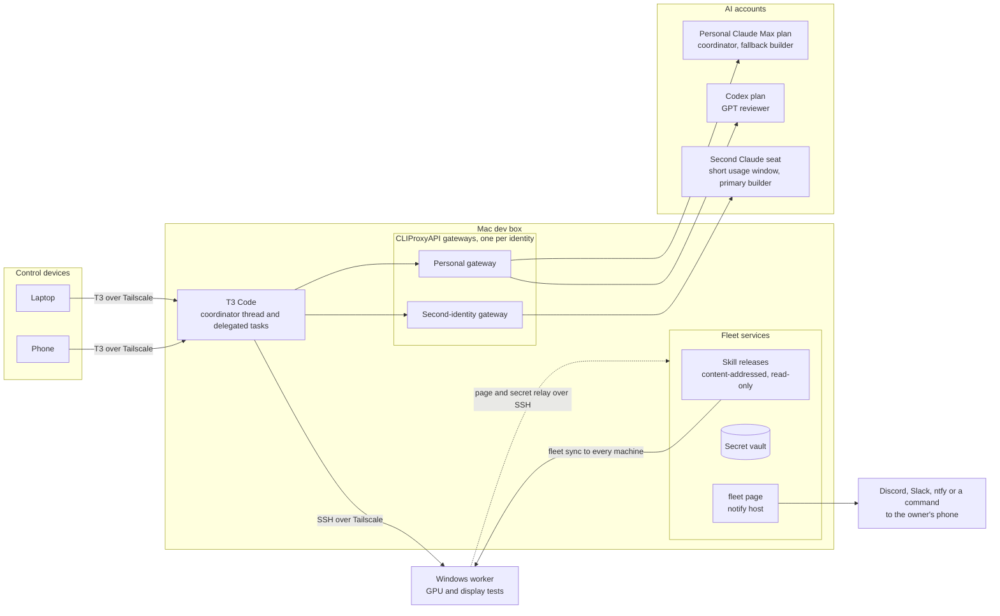

# Ali's agentic workflow

This is how Ali runs a few machines and three AI accounts as a small development team. A coordinator agent in T3 Code plans the work, hands builds to one account and reviews to another, and moves builds to a fallback account when a usage window runs out, then back when it reopens. When an agent hits something only Ali can clear, like a UAC prompt on the Windows PC, it pages him in three sentences or fewer. Keys live in one vault, and every machine runs the same pinned release of the skills. Everything specific to Ali sits in two config files, so you can run the same setup with your own machines and accounts.

## How it fits together



Ali drives everything from his laptop or phone. The Mac dev box runs T3 Code and one CLIProxyAPI gateway per identity, so the personal accounts and the second seat never share a login. The gateways record each response's rate-limit headers, which is how the coordinator knows when an account is close to its limit. The Windows PC takes native GPU and display tests over SSH. The Mac also hosts the vault, the paging relay and the skill releases that `fleet sync` pushes to every machine.

## Highlights

The output below is real. It was captured in an empty home directory against the config from the [Quick start](#quick-start) and the example trifecta config, with temporary paths shown as `~/` and `...` where fields were cut. `fleet` is `scripts/fleet` or the launcher `fleet sync` installs on each machine.

### orchestrate-trifecta: one coordinator, separate builders and reviewers

A Claude Code skill for long builds in T3. The coordinator writes no feature code. It briefs builders through `delegate_task`, sends each result to a reviewer from a different model family (70% GPT, 30% Claude by default), has the builder fix the findings, and asks for a confirming review before it merges. Roles come from your own `trifecta.json`.

```text
/orchestrate-trifecta Port the export command to Windows and add tests
```

From that one line the coordinator checks its config and usage readings, writes down what done means as runnable checks, and keeps a progress file another thread could resume from. It reports verified results, the review tally and the final usage readings.

The [trifecta README](skills/orchestrate-trifecta/README.md) explains the roles and has a [sequence diagram of one run](skills/orchestrate-trifecta/README.md#one-run), including a failover and the return to the primary builder.

### Gateways and usage-aware failover

Each builder has a `switch_at_percent`. Before each wave of builds the coordinator reads every usage window the gateways report for each role. A builder at its threshold gets nothing large, and a builder that fails with a usage-limit error hands its work to the next builder in order. `usage.py --sleep-until-reset builder1` then runs in the background and wakes the thread when the window reopens. Validating the example config makes no network request:

```console
$ TRIFECTA_CONFIG=skills/orchestrate-trifecta/trifecta.example.json \
    python3 skills/orchestrate-trifecta/scripts/usage.py --check-config
config: skills/orchestrate-trifecta/trifecta.example.json

ROLE         LABEL                            PROVIDER INSTANCE          MODEL              OPTIONS                    USAGE                RULE
coordinator  Coordinator account              claudeAgent_coordinator    -                  {}                         coordinator-claude   coordinates; the thread you are in
builder1     Builder seat                     claudeAgent_builder        claude-opus-5-5    {"effort": "high"}         builder-claude       switch at 85%
builder2     Coordinator account (fallback)   claudeAgent_coordinator    claude-opus-5-5    {"effort": "high"}         coordinator-claude   switch at 85%
reviewer1    GPT reviewer                     codex                      gpt-6.1-sol        {"reasoningEffort": "high"} reviewer-codex       weight 7 (70% of reviews)
reviewer2    Claude reviewer                  claudeAgent_builder        claude-opus-5-5    {"effort": "high"}         builder-claude       weight 3 (30% of reviews)

max_parallel_builders: 2
stale_minutes: 20
never_use: claudeAgent_direct, codex_old_seat

usage sources:
  coordinator-claude: cliproxyapi http://127.0.0.1:8317 provider=claude unit=fraction key_file=~/.config/trifecta/main-gateway.json  (key file not found yet)
  builder-claude: cliproxyapi http://127.0.0.1:8318 provider=claude unit=fraction key_file=~/.config/trifecta/builder-gateway.json  (key file not found yet)
  reviewer-codex: cliproxyapi http://127.0.0.1:8317 provider=codex unit=percent key_file=~/.config/trifecta/main-gateway.json  (key file not found yet)
```

The gateway setup is in the [proxy module](docs/modules/proxy.md).

### `fleet page`: a last resort that reaches your phone

An agent stuck on a UAC prompt, a macOS password or a 2FA code sends one to three sentences through the channels in `fleet.json`. Each agent session can page once per 30 minutes, and the report in the thread is still the main way an agent reaches you. A dry run shows each channel's request with vault references in place of the URL and topic. The Quick start config has one ntfy channel. This page came from a Codex session in `~/code/my-app`, and the title names the machine, the session's profile and the folder:

```console
$ fleet page --dry-run 'The Windows build is waiting on a UAC prompt on mainpc. Approve it at the PC; nothing else in the task can continue until then.'
{
  "channel": "ntfy",
  "type": "ntfy",
  "url": "https://ntfy.sh/<vault secret personal/FLEET_PAGE_NTFY_TOPIC>",
  "headers": {
    "Title": "devbox1 · personal-codex · my-app",
    "Content-Type": "text/plain; charset=utf-8"
  },
  "body": "The Windows build is waiting on a UAC prompt on mainpc. Approve it at the PC; nothing else in the task can continue until then."
}
Dry run: nothing was sent and the page limit is unchanged.

$ fleet page --dry-run 'One. Two. Three. Four sentences is too many.'
fleet: A page is one to 3 sentences and at most 500 characters; this has 4 sentences and 44 characters
```

Channels: `discord-webhook`, `slack-webhook`, `ntfy`, `openclaw` and `command`, tried in order until one accepts. See the [paging module](docs/modules/paging.md).

### `fleet secret`: keys go in the vault as soon as they exist

When an agent creates a bot token or API key, it saves it right away, and it checks the vault before asking you for one. Values go in on stdin and come out inside `$(...)`, so they never land in a command line or a transcript.

```console
$ printf '%s' "$TOKEN" | fleet secret set DISCORD_EXAMPLE_BOT_TOKEN --scope personal \
    --note 'Bot token for the example Discord bot, from the personal developer account'
Saved personal DISCORD_EXAMPLE_BOT_TOKEN.
$ fleet secret list
personal      DISCORD_EXAMPLE_BOT_TOKEN                2026-10-31  Bot token for the example Discord bot, from the personal developer account
$ printf '%s' x | fleet secret set DISCORD_EXAMPLE_BOT_TOKEN --scope personal --note again
fleet: personal DISCORD_EXAMPLE_BOT_TOKEN already exists. Pass --replace only to rotate it; the vault keeps the old value.
```

See the [vault module](docs/modules/vault.md).

### Skill releases and `fleet sync`

`fleet release` copies the skills into a read-only folder named by their content hash. `fleet sync --apply` points every profile on every machine at it, so a Mac and a Windows PC run the same skill versions. Old releases stay in place for sessions still using them. Claude-only skills reach only personal Claude profiles.

`fleet init` lists your existing Codex and Claude homes as native profiles, and sync leaves native homes alone by default, so with the Quick start config `fleet sync --check` reports `"profiles": 0`. To have sync link skills into those homes, set `sync.include_native` to `true` in your `fleet.json`. Sync adds links next to your own skills and stops with a problem instead of replacing one. This run did that with the four homes the Quick start config names. After `fleet sync --apply`, the personal Claude home had 23 skills, including the three Codex bridges, and the Codex and work homes had 18 each.

```console
$ fleet release
~/Services/fleet/releases/44204301cc7a721cc676
$ fleet sync --apply > /dev/null
$ fleet sync --check
{
  "revision": "44204301cc7a721cc676",
  "profiles": 4,
  "problems": []
}
```

A LaunchAgent on the sync host repeats this every two minutes and updates the other machines over SSH. See [skill synchronization](docs/fleet-cli.md#skill-synchronization).

### `fleet task` worktrees and build leases

A task gets its own branch and worktree from the repository's committed HEAD, so uncommitted work in your checkout stays untouched. A lease keeps two heavy builds from running at once on one machine.

```console
$ fleet task ~/code/my-app fix-export --profile personal-codex --done 'Export works and the unit tests pass'
Preparing worktree (new branch 'fleet/fix-export')
HEAD is now at 468edf6 init
{
  "task": "fix-export",
  "machine": "devbox1",
  "profile": "personal-codex",
  ...
  "worktree": "~/Services/fleet/worktrees/my-app-32a36590/fix-export",
  "done": "Export works and the unit tests pass",
  ...
}
$ fleet lease heavy-build -- sh -c 'echo building'
building
```

### `fleet claude-debug`: one direct request, only when asked

Most traffic goes through the gateways. When Ali needs to know whether a problem is the gateway's or the account's, `claude-debug ask` sends one tiny request to a direct Claude login, with no tools, no MCP servers, a spending cap and a required `--reason`. It refuses a home signed in to an account other than the configured email, and it does nothing until you configure it:

```sh
fleet claude-debug ask personal 'Say ok.' --model claude-opus-5-5 --fast --reason 'Does the account allow fast mode?'
```

```console
$ fleet claude-debug status personal     # a config without a debug section
fleet: claude-debug is not configured. Add debug.claude entries with each direct home and its account email to fleet.json (see docs/fleet-cli.md).
```

### Claude-to-Codex bridges

Three Claude skills hand specialized work to a personal Codex login: [codex-image](skills/codex-image/README.md) generates raster art, [codex-3d](skills/codex-3d/README.md) builds three.js, Blender and SVG objects, and [codex-computer-use](skills/codex-computer-use/README.md) drives a running page in headless Chrome and reports defects with evidence. Every picture below is real output stored in the repo.

<table>
  <tr>
    <td></td>
    <td></td>
    <td></td>
  </tr>
  <tr>
    <td colspan="3">codex-image: a hero, a transparent cutout and a device mockup. The <a href="skills/codex-image/examples/demo-screenshot.png">demo page</a> uses them with real HTML text on top.</td>
  </tr>
  <tr>
    <td></td>
    <td></td>
    <td></td>
  </tr>
  <tr>
    <td colspan="3">codex-3d: one spec built as a three.js module, an SVG with wheels in their own pivot groups, and a Blender GLB with 106 named nodes.</td>
  </tr>
  <tr>
    <td></td>
    <td></td>
    <td></td>
  </tr>
  <tr>
    <td>Run 1, FAIL: overflow and a 1.13:1 contrast paragraph.</td>
    <td>Run 2, FAIL: Claude's fix grew the grid track instead of truncating.</td>
    <td>Run 3, PASS after applying the reviewer's <code>minmax(0, 1fr)</code> fix.</td>
  </tr>
</table>

The [computer-use example](skills/codex-computer-use/examples/README.md) has all three reports and the diff.

### Public-safety tooling

The repo is public, so every push runs a checker for home paths, tailnet details, real-looking email addresses, private state files and Gitleaks' secret rules. Names that only you know are private (a surname, an employer, a bot name) go in a deny-list kept outside Git. A finding names the file, the line and the deny-list line, never the matched text. Here it is on a scratch repository with three planted problems:

```console
$ python3 scripts/check-public.py --denylist ~/.config/public-check/denylist.txt
working-tree: denylisted-term (deny-list line 1): notes.md:4
working-tree: personal-home: notes.md:2
working-tree: personal-email: notes.md:3
Public check failed: 3 location(s). Values withheld.
```

With `--history` or `--range` it also requires every commit's author and committer email to be a GitHub noreply address. The pre-push hook runs the same check on the commits a push would publish. CI runs it on every push without your deny-list. See [public release checks](docs/public-release.md).

## Quick start

You need Python 3.11 or newer. Nothing below signs in, installs a service or opens a port.

```sh
git clone https://github.com/whoisaldo/aldos-agentic-workflow.git
cd aldos-agentic-workflow

# 1. Write fleet.json for your own machines, identities and paging channel. It goes outside
#    the checkout, so the tracked starter file stays as shipped and the export in step 3 works.
#    In a terminal, init prompts for anything you leave out.
scripts/fleet init --owner 'Your name' --state-dir '~/Services/fleet' \
  --machine 'devbox1,os=macos,user=your-user,address=100.64.0.1,ssh=devbox1,roles=development+macos' \
  --machine 'mainpc,os=windows,user=your-user,address=100.64.0.2,ssh=mainpc,roles=windows+gpu+display' \
  --identity personal --identity work --notify ntfy --output ~/.config/fleet/fleet.json
export FLEET_CONFIG=~/.config/fleet/fleet.json   # every fleet command reads this file

# 2. Validate it. Prints one line per problem, or "<path>: valid".
scripts/fleet config check

# 3. Pick a preset and export only that selection to a new folder.
python3 scripts/bank.py plan --preset personal-code
python3 scripts/bank.py pull --preset personal-code --output ../my-fleet-kit

# 4. Install the trifecta skill from the kit for Claude Code, then configure and validate it.
mkdir -p ~/.claude/skills
test ! -e ~/.claude/skills/orchestrate-trifecta && test ! -L ~/.claude/skills/orchestrate-trifecta && \
  cp -R ../my-fleet-kit/skills/orchestrate-trifecta ~/.claude/skills/orchestrate-trifecta
cp -n ~/.claude/skills/orchestrate-trifecta/trifecta.example.json ~/.claude/skills/orchestrate-trifecta/trifecta.json
python3 ~/.claude/skills/orchestrate-trifecta/scripts/usage.py --check-config

# 5. Check your own commits before every push.
git config core.hooksPath .githooks
```

Add the `export FLEET_CONFIG=...` line to your shell profile so later sessions use the same file.

The hook can also read a private deny-list of names only you know, such as a surname or an employer. Skip this if you have none yet. Create the file before you point Git at it. Each line is a case-insensitive regular expression, and lines starting with `#` are comments. [Public release checks](docs/public-release.md) explains how the hook uses it.

```sh
mkdir -p ~/.config/public-check
test -e ~/.config/public-check/denylist.txt || cat > ~/.config/public-check/denylist.txt <<'LIST'
# One term per line. These examples are fictional; replace them with your own.
# Jane Q\. Example
# Acme Widgets
LIST
git config publiccheck.denylist ~/.config/public-check/denylist.txt
```

[Installing skills](docs/install-skills.md) covers Codex, Claude Code and OpenClaw destinations. In step 4, replace every provider instance id in `trifecta.json` with one from your own T3 `orchestrator_capabilities` catalog.

You can also open the clone in your coding agent and paste [HANDOFF.md](HANDOFF.md). It asks about your OS, accounts and goals, suggests a small selection, and offers to run `fleet init` and set up `trifecta.json` with you.

## Configuration

Two files hold everything specific to one owner. Neither holds a credential: secrets are references to vault entries or environment variables.

| Section | What it sets |
| --- | --- |
| `owner`, `state_dir` | Your name, and the private folder outside Git for releases, tasks, leases, pages, the vault and logs |
| [`machines`](docs/fleet-cli.md#machines) | Each machine's OS, user, Tailscale address, SSH alias, roles and optional paths |
| `profiles` | Codex and Claude homes per identity: native homes stay read-only, managed homes get a model, effort and gateway |
| [`gateway`, `additional_gateways`](docs/modules/proxy.md) | One CLIProxyAPI gateway per identity: URL, pinned version and checksum, runtime folder, expected sign-in email |
| `protected_services` | Services agents must leave alone, such as the T3 desktop app's port |
| [`skill_policy`](docs/fleet-cli.md#skill-synchronization) | Which identities count as personal and receive Claude-only skills |
| [`notify`](docs/fleet-cli.md#paging-the-owner) | `fleet page`: host, limits and ordered channels |
| [`secrets`](docs/fleet-cli.md#secrets) | `fleet secret`: vault host and scopes |
| [`sync`](docs/fleet-cli.md#skill-synchronization) | `fleet sync`: host, peer machines, interval and service label |
| [`debug`](docs/fleet-cli.md#claude-without-the-gateway) | `fleet claude-debug`: direct Claude homes and their expected emails |
| [`trifecta.json`](skills/orchestrate-trifecta/README.md#config-reference) | Coordinator, ordered builders, weighted reviewers, `never_use` and usage sources |

The [fleet CLI reference](docs/fleet-cli.md) documents every command and key. `fleet.schema.json` gives editors completion and validation.

## The bank selector

This repo is also a bank you can take pieces from. `scripts/bank.py` lists modules, skills and presets, plans a selection with its dependencies, and copies only that selection into a new folder with a hash manifest. It installs nothing.

```sh
python3 scripts/bank.py list
python3 scripts/bank.py plan --preset personal-code --module tailscale --module paging
python3 scripts/bank.py pull --skill unslop --skill resume-craft --output ../writing-kit
python3 scripts/bank.py plan --preset personal-code --skip-skill baseline-ui
```

| Preset | A useful start for | Leaves out |
| --- | --- | --- |
| minimal | Portable UI and writing skills | All services and account setup |
| personal-code | Local coding with T3 and the trifecta build/review workflow | School, OpenClaw, proxy and tunnels |
| work-code | Coding in your employer-approved environment | Personal bridges, proxy and school workflows |
| student | OpenClaw, general Canvas planning and document review | Coding proxy, video and tunnels |
| remote | T3, private networking, paging, friend previews and proxy profiles | School, assistant and video |
| creative | Design, video, resume and the Claude-to-Codex bridges | School and remote networking |
| everything | The whole bank for reference | Nothing, but nothing is enabled |

Modules: [coding agents](docs/modules/coding-agents.md), [T3 Code](docs/modules/t3-code.md), [trifecta](docs/modules/trifecta.md), [fleet tools](docs/modules/fleet-tools.md), [paging](docs/modules/paging.md), [vault](docs/modules/vault.md), [inference proxy](docs/modules/proxy.md), [Tailscale](docs/modules/tailscale.md), [Cloudflare Tunnel](docs/modules/cloudflare.md), [personal bridges](docs/modules/personal-bridges.md), [video](docs/modules/video.md), [OpenClaw](docs/modules/openclaw.md), [OpenClaw visual canvas](docs/modules/openclaw-canvas.md), [Canvas LMS](docs/modules/canvas-lms.md), [document reviews](docs/modules/document-reviews.md), [provider skills](docs/modules/provider-skills.md), [assistant extras](docs/modules/assistant-extras.md) and [legacy](docs/modules/legacy.md). Each page says when to use it, when to skip it, what it needs and how to check it. [The skill catalog](docs/skills.md) describes the 26 bundled skills.

`--without MODULE` drops a module unless something you kept needs it; the selector reports the conflict instead of silently dropping a requirement. `pull` refuses to write into an existing folder and copies only files listed in `bank/files.json` whose hashes match.

## Safety and privacy

The repo never contains credentials, OAuth state, session databases, private memory, device grants, logs, backups, `trifecta.json` or the deny-list. `fleet.json` names vault entries and environment variables instead of webhook URLs or tokens, and `fleet config check` rejects a literal one. Example addresses are `100.64.0.1` to `100.64.0.3`, and example emails use `example.com`.

Before a commit, refresh the inventory and run the checks:

```sh
python3 scripts/index-bank.py && git add bank/files.json
python3 -m unittest discover -s tests -v
python3 scripts/check-public.py --history --secrets --denylist ~/.config/public-check/denylist.txt
```

The tests use temporary homes, repositories and a fake gateway. They do not prove that your accounts, models, tunnels or Windows display tests work; each module page lists its own live check. A clean scan is also not proof that every screenshot or document is fine to publish, so review media and metadata yourself. If a real credential was ever committed, rotate it with its issuer first; rewriting Git history does not reach existing clones. To report a problem in this repo, see [SECURITY.md](SECURITY.md).

Personal and employer accounts stay separate. A work identity is not permission to use a personal gateway or the Claude-to-Codex bridges. Use your employer's approved environment for its work.

## License

Ali's code and docs are under the [MIT License](LICENSE). Vendored skills under `vendor/skills/` keep their upstream licenses and notices, and the files in [`bank/licenses/`](bank/licenses) keep their own terms. [Provenance](docs/provenance.md) lists where imported material came from.
