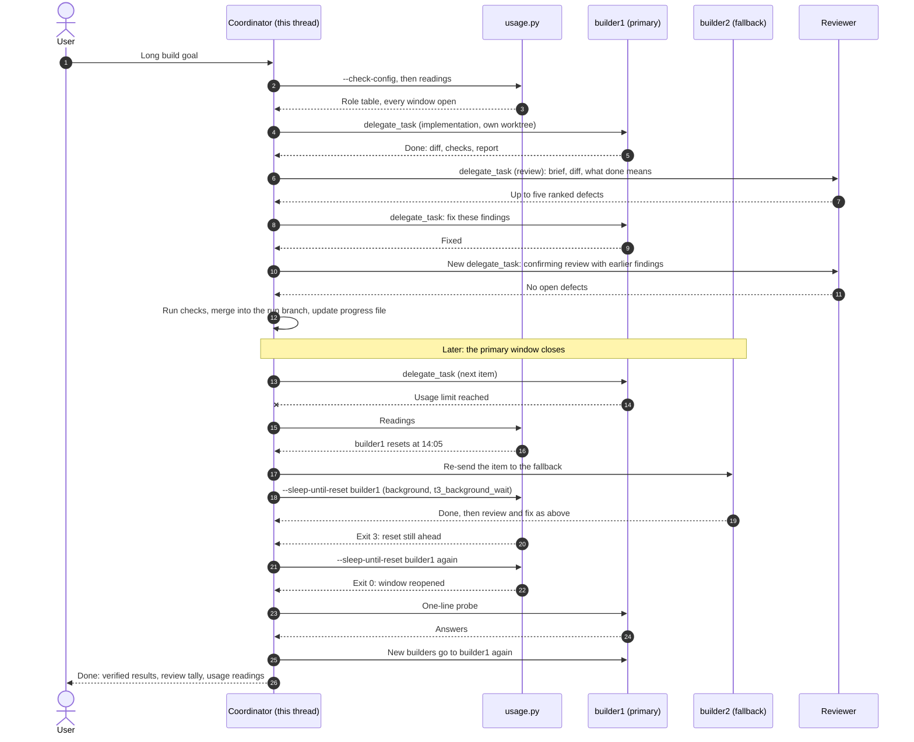

# Orchestrate trifecta

A workflow for long builds in [T3 Code](../../docs/modules/t3-code.md):
one thread coordinates, other accounts build, and other accounts review, all
through T3's `delegate_task` orchestrator. When a builder account's usage
window closes, building moves to a fallback account and comes back when the
window reopens, so the run keeps going without anyone watching it.

The skill is a Claude Code skill (`SKILL.md`), a config file you write once
(`trifecta.json`), and a small read-only helper (`scripts/usage.py`) that
shows each role's latest usage reading.

## Why several accounts

Every plan has usage limits, often a short window, a longer one, or both.
Check your plan for their lengths. A single account doing everything hits the
first limit and the run stops until it resets. Splitting the work by role means:

- **The coordinator's budget goes on decisions.** Planning, briefing,
  merging and checking are cheap. Writing code and reading large files are
  not, so the coordinator hands them out.
- **Builders use the account that is cheapest to exhaust.** Put first the
  account whose limit costs least to run out, such as a second Claude seat
  with a short usage window. The coordinator's own account is the fallback.
- **Reviews come from a different kind of reader.** By default 70% of reviews
  go to a GPT model and 30% to Claude. A model reviewing its own family's work
  tends to miss the same things that model got wrong in the first place.
- **No single limit stops a run.** When a window closes, work moves; when it
  reopens, work moves back.

## Roles and failover

| Role | Does | Example account |
| --- | --- | --- |
| Coordinator | Plans, briefs, merges, runs checks, decides. Writes no feature code. | your main Claude account (this thread) |
| `builder1` | Builds. Primary. | a second Claude seat with a short usage window |
| `builder2` | Builds while `builder1` is closed. | the coordinator's own account |
| `reviewer1` (weight 7) | Reviews most items. | a Codex account running a GPT model |
| `reviewer2` (weight 3) | Reviews the final pass and disputed findings. | Claude on the builder seat |

Failover is driven by readings and failures:

1. Before each wave of builders the coordinator runs `usage.py`. A builder
   with any usage window the gateway reports at or above its `switch_at_percent`
   (default 85%) gets nothing large.
2. When a builder fails with a usage-limit error, the coordinator records the
   reset time, re-sends the cut-off work to the next builder in order, and
   starts `usage.py --sleep-until-reset builder1` as a background command.
3. That command sleeps until a minute after the latest reset among the
   windows that block the role, at most 110 minutes per run. A longer window
   that ran out still blocks after the shorter one resets. Exit code 3 means the reset is still ahead, so the coordinator
   starts it again. Exit code 0 means the window has reopened.
4. The coordinator probes `builder1` with a one-line task and moves new
   builders back. Builders already running on the fallback finish there.

T3 threads do not fire timers such as ScheduleWakeup, but a finishing
background command wakes the thread. The coordinator marks the clock with
`t3_background_wait` so T3 shows the thread as Working while it sleeps.

## One run



## Setup

1. **T3 Code with your accounts.** Add each account as a provider instance in
   T3 and confirm they appear in `orchestrator_capabilities` with
   `canRunCrossProviderChildTask: true`. Note each instance id, model id and
   option names from that catalog.
2. **A usage source (optional but recommended).** `usage.py` reads the
   management API of a [CLIProxyAPI](https://github.com/router-for-me/CLIProxyAPI)
   gateway, which records the rate-limit headers of every response it
   forwards. Route the builder and reviewer instances through a gateway to
   make their windows visible. Save each gateway's management key in a local
   JSON file outside any repository, for example
   `~/.config/trifecta/builder-gateway.json` containing
   `{"management_key": "..."}`, readable only by you. Without a usage source
   the workflow still runs; failover then goes by limit errors alone. See
   [the proxy module](../../docs/modules/proxy.md) for gateway setup.
3. **Install the skill.** Copy this folder to `~/.claude/skills/orchestrate-trifecta`
   (see [installing skills](../../docs/install-skills.md)).
4. **Write your config.** Copy `trifecta.example.json` to `trifecta.json` in
   the installed skill folder, or anywhere you like with `TRIFECTA_CONFIG`
   pointing at it. Replace every id with the ones from step 1. `trifecta.json`
   is ignored by Git in this repository; keep it out of any public repo.
5. **Check it.**

   ```sh
   python3 ~/.claude/skills/orchestrate-trifecta/scripts/usage.py --check-config
   python3 ~/.claude/skills/orchestrate-trifecta/scripts/usage.py
   ```

   The first validates the config and prints the role table without any
   network request. The second prints each role's reading.
6. **Run it.** In a T3 thread on the coordinator account, say "/orchestrate-trifecta"
   with your goal, or "use my workflow".

## Config reference

| Key | Required | Default | Meaning |
| --- | --- | --- | --- |
| `coordinator.label` | yes | | Name of the account this thread runs on |
| `coordinator.providerInstanceId` | no | | Instance to refresh the coordinator's reading through |
| `coordinator.usage` | no | | Name of a usage source |
| `builders[]` | yes | | Ordered list: primary first, then fallbacks |
| `builders[].label`, `.providerInstanceId`, `.model` | yes | | Account name, T3 provider instance and model id |
| `builders[].options` | no | `{}` | T3 target options, such as `{"effort": "high"}` |
| `builders[].usage` | no | | Name of a usage source |
| `builders[].switch_at_percent` | no | `85` | Start nothing large here at or above this share of its window |
| `reviewers[]` | yes | | Reviewer accounts |
| `reviewers[].label`, `.providerInstanceId`, `.model`, `.options`, `.usage` | | | As for builders |
| `reviewers[].weight` | for other providers | `7` Codex/GPT, `3` Claude | Share of reviews, relative to the other weights |
| `max_parallel_builders` | no | `2` | Builders running at once |
| `never_use` | no | `[]` | Provider instance ids never to start anything on |
| `stale_minutes` | no | `20` | Readings older than this are marked STALE |
| `usage_sources.NAME.type` | yes | | `cliproxyapi`, the gateway's `/v0/management/auth-files` API |
| `usage_sources.NAME.url` | yes | | Gateway base URL |
| `usage_sources.NAME.key_file` | yes | | Local JSON file with a `management_key` field |
| `usage_sources.NAME.provider` | yes | | Which auth entry in the gateway to read, such as `claude` or `codex` |
| `usage_sources.NAME.used_unit` | no | `fraction` | `fraction` (0 to 1) or `percent` (0 to 100) |
| `usage_sources.NAME.fields` | yes | | Header names for `five_hour_used`, `five_hour_reset`, `weekly_used`, `weekly_reset` and `status`; at least one `*_used` |

Keys starting with `_` are ignored, for comments. Unknown keys are errors, so
a typo cannot silently fall back to a default. Several roles can share one
usage source, and several sources can share one gateway; each gateway is
asked once per run.

These environment variables override the URL and key file of a role's usage
source: `TRIFECTA_COORDINATOR_GATEWAY_URL`, `TRIFECTA_COORDINATOR_KEY_FILE`,
`TRIFECTA_BUILDER_GATEWAY_URL`, `TRIFECTA_BUILDER_KEY_FILE` (for `builder1`),
`TRIFECTA_REVIEWER_GATEWAY_URL` and `TRIFECTA_REVIEWER_KEY_FILE` (for
`reviewer1`). They apply on top of a config; they do not replace one.

## usage.py

| Command | Does | Exit |
| --- | --- | --- |
| `usage.py` | One line per role: use and reset for each configured window (`five_hour`, `weekly`), age, STALE, AT THRESHOLD | 0; 1 if the config is invalid |
| `usage.py --json` | The same as JSON, with `blocking_reset`: when the last blocking window resets | as above |
| `usage.py --check-config` | Validates the config and prints the role table; no network | 0 valid, 1 missing or invalid |
| `usage.py --sleep-until-reset ROLE` | Sleeps until a minute after the latest reset of ROLE's blocking windows, at most 110 minutes | 0 reopened or nothing pending, 3 run again, 1 no valid config |

Without a config the helper says what is missing and makes no network
request. With one it only reads usage. It never signs in, switches accounts
or starts tasks. Tests: `python3 -m unittest tests.test_trifecta -v` from the
repository root; they use a local fake gateway and an injected clock.
